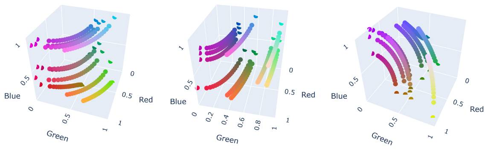
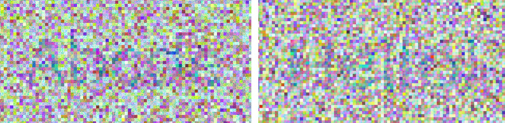
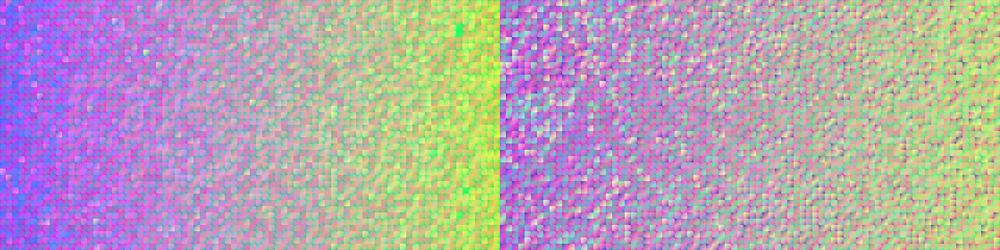
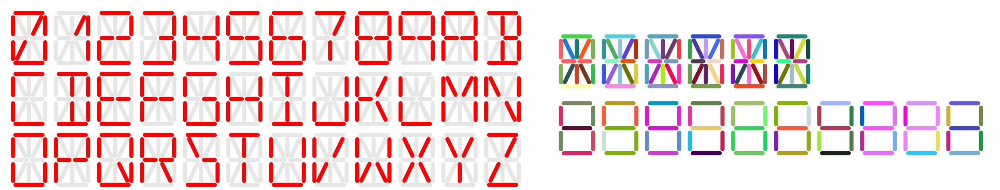
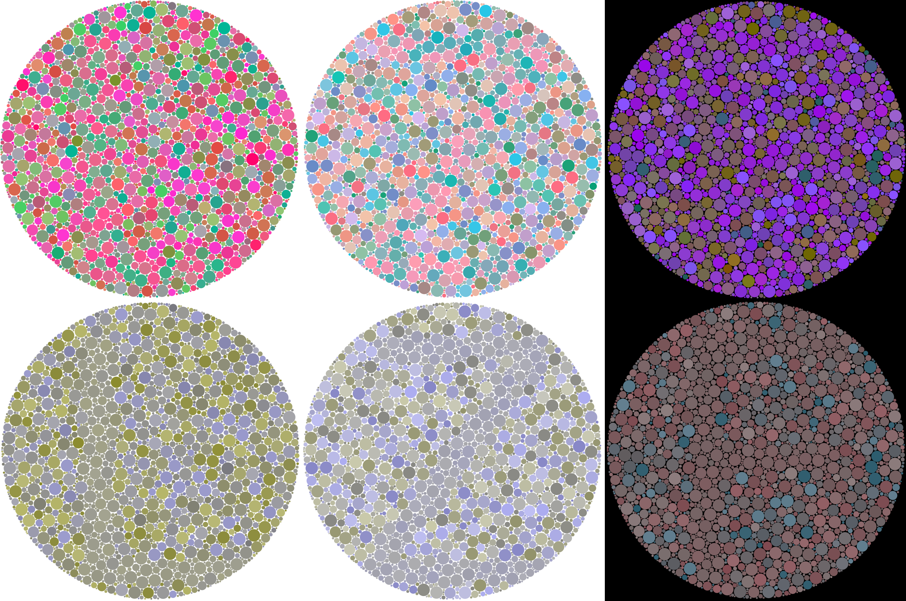

# Colourblind Steganography

This project is an attempt at creating images with content that is **visible to the colourblind and invisible to regular people (i.e. "reverse-colourblindness").**  One may be much more familiar with the opposite task -- content that is visible to regular people and invisible to the colourblind -- which by definition is much easier to accomplish.

## Background

The task at hand relies on **confusion lines**, sets of curved 3D lines in RGB space representing colour gradients that converge visually such that colours in the gradient look the same to the colourblind. Below, from left to right, are examples of confusion lines for the three types of colourblindness: **deutans** (green-deficient), **protans** (red-deficient), and **tritans** (blue-deficient). This [link](https://daltonlens.org/understanding-cvd-simulation/) has a much more technical and interactive explanation of how this works; to summarize, RGB coordinates can be transformed to a space called LMS where coordinates represent how much the long (L), medium (M), and short (S) cone cells in our eyes respond to a given colour. A confusion line is derived by starting with any point and moving in the direction of the L (protan), M (deutan), or S (tritan) axis.

To make a colourblind-invisible scene, the easiest way is to choose two colours from a confusion line (the closer they are, the harder to distinguish) and use them for your foreground/background colours. The Ishihara plate (example below for deutans, contains "6") is an archetypal example.

To make a colourblind-visible scene, one way is to create a confusion line and a few sets of "distractor" colour groups; colourblind people collapse the confusion line into a single colour while regular people see the line as indistinguishable from the distractor colours. Thus, the foreground/background should be coloured with colours from the confusion line or distractors in such a way so the background blends into one and the foreground does not for the colourblind. Ishihara "hidden plates" (see below, left) are examples of this, with content visible only to the colourblind (see below, right for a simulated deutan view).

The Ishihara plates however present a few problems:

- They are hand-made. While there exist [algorithmic methods](https://franciscouzo.github.io/ishihara/) to generate Ishihara plates online, all the ones I found were for the colourblind-invisible case. But it is also possible my Googling game is weak.

- The colourblind-visible plates 18-21 in the most commonly-used [38 Ishihara plate edition](https://www.challengetb.org/publications/tools/country/Ishihara_Tests.pdf), which are most relevant to this project, are not visible to me (a deutan). This [survey](https://pubmed.ncbi.nlm.nih.gov/8510946/)'s results agree with observations, with >50% of colourblind people seeing nothing across most of these plates.

- [This](https://www.color-blind-test.com/hidden-plates-more), [this](https://reversecolorblind.com/), [this](https://okkl.co.uk/blogs/news/reverse-colorblind-test), and [this](https://www.reddit.com/r/ColorBlind/comments/1q4vjng/reverse_colorblind_test_red_green_deuteranomaly/) all rely on creating extremely noticeable colourblind-invisible textures that dazzle people, making them less likely to notice the "hidden" content. While this method produces colourblind-visible content rather reliably, its effectiveness against regular vision is mixed and very content-dependent. This is because the intersection of the content with the texture produces many same-colour clusters that provide spatial hints for identifying the content. It is also difficult to generate good and varied textures that people would not get used to.

While less common, non-Ishihara approaches have been proposed [here](https://www.cs.unm.edu/~aaron/creative/colorTest.htm) and [here](https://isohedral.ca/dichromatic-steganography/). Both examples in the first source do not succeed; approach 1 is visible according to one of my family members with regular vision, while approach 2 is invisible to me. For the second source, the author admits the content is visible to them (they have regular vision).

To fill in these gaps, this research aims to provide algorithmic methods to create scenes with content visible to the colourblind and invisible to regular people.

## Methodology

The project workflow was (a) making deutan-visible images, (b) using my own perception to check for deutan-visibility, (c) pasting the image into [Photopea](https://www.photopea.com/) and changing the hue to simulate normal vision, and (d) checking with family members (with regular vision). For other colourblindness types, I used code from [DaltonLens](https://daltonlens.org/understanding-cvd-simulation/) to simulate protan/tritan vision and check for colourblind-visibility.

My approach focused primarily on creating convincing distractors. Starting from a colour and its confusion line, I created distractor lines using a combination of these methods:
- Jittering the starting/ending points of the confusion line in some colour space
- Drawing a line between the starting/ending points on a non-LMS colour space (RGB, OKLAB, linear RGB, etc.)
- Drawing a line by moving in a non-axial direction in LMS space
- Multiplying each channel by a random near-1 value, jittering it slightly
- Sampling the ends of the confusion/distractor lines more often than the center. Specifically, using the random variable $Y = (X + 0.5) \mod{1}$ where $X \sim \text{Beta}(4, 4)$

It was extremely time-consuming and difficult to create distractors both similar enough to the confusion line to confuse regular viewers, but also distinct enough for colourblind viewers to perceive. This delicate balance was also scene-specific -- different approaches and colourblindness types could not always reuse the same distractors.

## Experiments

### Noisy Grid

The idea is to take a foreground/background boolean 2D matrix, then for each individual pixel magnify it into a $n \times n$ square. The square is coloured with a confusion line or distractor line depending on its boolean value. Theoretically, colourblind viewers observe the smooth-grainy contrast to make out the hidden content, while regular viewers observe graininess everywhere.

Early iterations of this idea were unfruitful. Due to the random starting colours, the contrast between neighbouring squares overwhelmed the smooth-grainy contrast, making it difficult to focus on the content (see image below). Furthermore, my method at the time was poorly-tested and unnecessarily complicated (some subjective constraints related to the start-end distance in LMS space and a RGB saturation metric); it did not hide the content convincingly.

I also experimented with a few designs:
- How the graininess was produced (left = noise, right = gradient) -- I felt the gradient made it slightly easier to get away with wider colour differences and survived image compression better
- Shape border colours (i.e. whether to add borders around squares) -- It only worsened legibility for all vision types

Later iterations of this idea tried to fix these flaws in a few ways. Instead of random colours, the starting colour was chosen from a random OKLAB gradient. The distractors were chosen by moving in a random direction parallel to the L-M axes in LMS space. This led to a remarkly more convincing illusion than before, but there remains quite a few weaknesses with this approach:
- Stepping in the S axis reveals the content immediately, so it cannot produce hidden text for tritans. I suspect this is because the L-M axes mostly correspond to changes in red/green-ness, while the S axis has a little bit of everything, which makes movements in this direction extremely obvious
- It needs separate tuning for deutans and protans 
- The algorithm is very unreliable: it takes many iterations to make content that is invisible in most alternate hues (and even so, some letter may be visible to regular vision as well).
- Even with smoother colours, the text is not very colourblind-visible and requires concentration to parse.
- The algorithm's reliance on fine-details results in larger image sizes. Compression artifacts from WEBP and JPG can make the content harder to see.

In conclusion, this method has potential but could use much fine-tuning that I lack the motivation to complete. The lack of tritan support is a big flaw that may require a change in how the distractors are generated for any future fix.

### Segment Displays

The first approach has a fundamental design issue: the abundance of coloured squares distracts everyone regardless of colourblindness and makes distractor distributions easier to notice as it samples more often. It seemed a better design should minimize the number of unique colours, and that inspired the idea of segment displays. The idea is to colour the segments inside/outside a character using colours from a confusion or distractor line. Colourblind people would notice the character while normal people would see random colours on each segment.

Two approaches were explored: a 7-segment and 14-segment display. The distractor colours were chosen as such:
1) Find a random colour (C0)
2) Randomly pick the start or the point of the confusion line (C1)
3) If the OKLAB space distance between C0 and C1 is within a certain threshold AND the colourblind-simulated distance is also within a certain threshold, choose the colour. Otherwise, go back to step 1

The 14-segment display was poor in visibility because it suffered the same problem as the first approach, that being too many colours and distractions. Furthermore, without a visual key (see below, left) to guide viewers for observe the correct segments, the content (see below, top-right) was even more difficult to discern.

Although the 7-segment option proved vastly superior, the illusion can be brittle. The constraints still have a chance of producing segments that are too distinct (giving away that it is OFF) or too similar to confusion line colours (which hurts legibility).

To summarize, this method stands out for its simplicity but suffers from a lack of expression, being unable to even display all letters of the alphabet in the most effective approach (7-segment).

### Ishihara

Having run out of extremely-simple ideas for scene generation, I fell back to the low-hanging fruit of the Ishihara setup and experimented with a "hidden plate" design. The idea was to start from a random colour and confusion line, then:

- For circles inside the foreground, sample the confusion line (sample the start/end more than the center).
- For circles inside the background, jitter the start/end points of the confusion line in OKLAB space, then randomly choose the next step:
  - Sample a colour from the line in LMS space made by these points
  - Sample a colour from the line in linear-RGB space made by these points
  - Sample a colour from the line in RGB space made by these points

All these distractor lines are similar enough to the original confusion line to confuse people with regular vision, but they should not confuse the colourblind, thus creating the hidden content.

The picture below contains some sample plates for deutans (left), protans (middle), and tritans (right) containing the original plate (top) and the simulated colourblind view (bottom) showing the content ("L", "Z", "F"). It requires zooming in and may be difficult to see even for the colourblind, but the content is certainly visible for deutans.

In my opinion, this is the most convincing approach to colourblind-invisible scenes (though the algorithm can be unreliable). Critically, it works for tritans and allows any arbitary boolean mask input. Additionally, it is robust to hue-shifts and can only be detected by simulating colourblindness, providing a strong steganographic strength.

## Conclusion

It is possible to create "reverse-colourblind" scenes algorithmically, with the Ishihara method seeing the most success (in my subjective opinion). Still, there are quite a few limitations with my methods:

- The content is often faint, and it is difficult to tell if it is a fine-tuning issue or if a completely new approach is necessary.
- The space-blindness of these algorithms make them unreliable. It is not difficult to see why most approaches focus on distracting textures that use space more deliberately.
- The sample size is one person and their family. I lack the social skills and willingness to reach out to anyone else willing to test this with a real cohort of clinically-confirmed colourblind people. If you, a random internet stranger, are interested in building on this or testing this, I would be happy to provide any help.

I thought this project would only take a week but it ended taking up almost a month because of the fucking fine-tuning. Goodbye

## Code

This project runs in Python 3.14 with the packages:

- `numpy`
- `Geometry3D`
- `pillow`
- `matplotlib`
- `plotly`
- `scipy`

See the `playground()` functions in the files named after the experiment for example usages.

Much code in this project is repurposed from [DaltonLens](https://daltonlens.org/understanding-cvd-simulation/), such as code for converting colour spaces (RGB, OKLAB, LMS), simulating colourblindness (vienot, brettel methods), and creating confusion lines. The Ishihara plate code uses a base SVG template which I generated from [this website](https://franciscouzo.github.io/ishihara/).